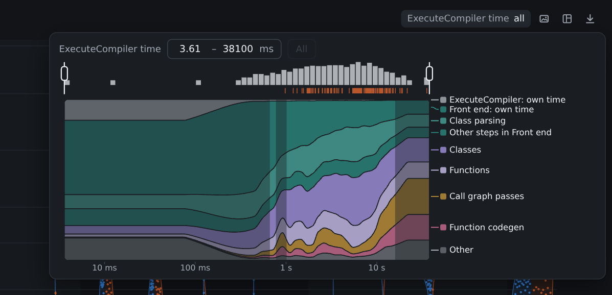
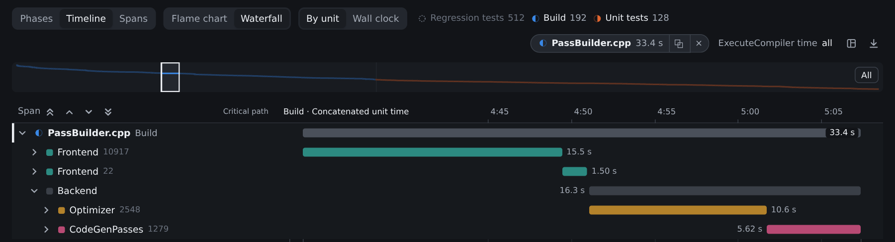
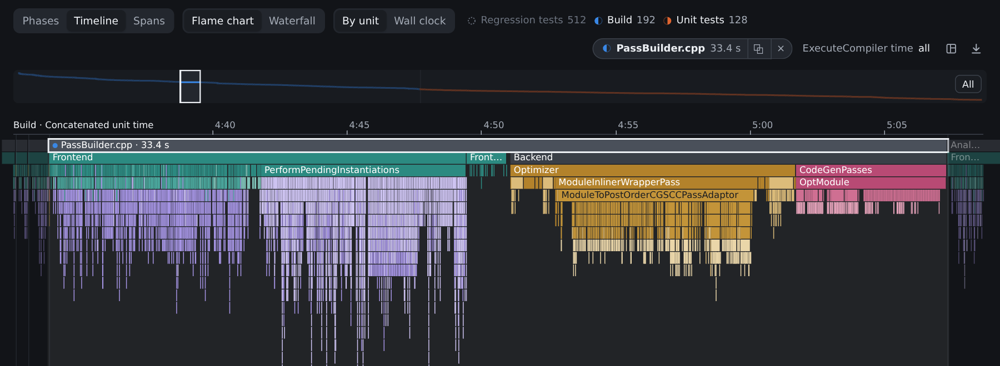
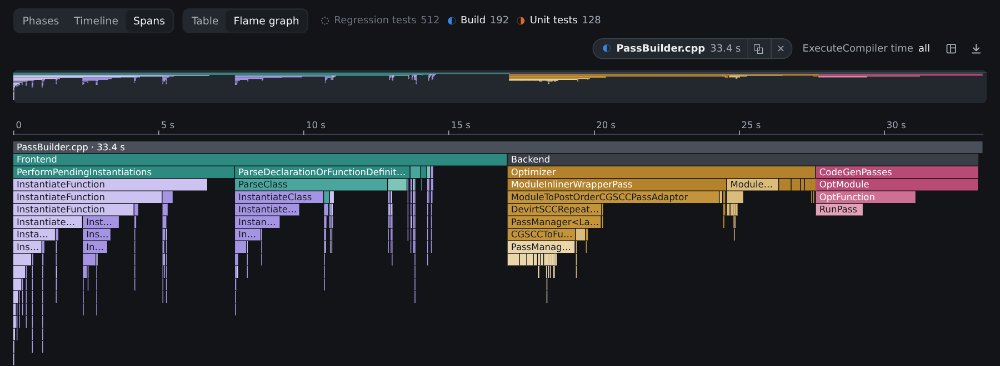

# Violinoscope

Compare where time goes across requests, compilations or sampled profiles. Each dot is one run; each violin is a phase you choose.

```sh
python3 violinoscope.py before.jsonl after.jsonl --unit "Handle request" -o report.html
```

Open `report.html` in a browser. It is self-contained and works offline. Generating it requires Python 3.9+; no server or JavaScript build step.

[**Open the Clang example**](https://raw.githack.com/alexpaniman/violinoscope/main/docs/clang.html) · [Collect your own](examples/clang/README.md)

The example samples 832 compilations from a full Clang build and test run. Blue is the build; orange is unit-test compilation. Templates are extracted into a group, with independent projections on the right.

[](docs/clang-phases.png)

<table>
  <tr>
    <td width="50%"><b>Time breakdown</b> · how costs change with compilation duration</td>
    <td width="50%"><b>Waterfall</b> · PassBuilder.cpp, folded to its main stages</td>
  </tr>
  <tr>
    <td><a href="docs/clang-time.png"></a></td>
    <td><a href="docs/clang-waterfall.png"></a></td>
  </tr>
  <tr>
    <td><b>Flame chart</b> · calls in execution order</td>
    <td><b>Flame graph</b> · repeated call paths combined</td>
  </tr>
  <tr>
    <td><a href="docs/clang-flame-chart.png"></a></td>
    <td><a href="docs/clang-flame-graph.png"></a></td>
  </tr>
</table>

Accepts **OpenTelemetry** OTLP/Collector JSON, Jaeger JSON, Chrome/Clang time traces and time-based Linux **perf** exports. Inputs can be files, directories, quoted globs or gzip files. Dataset names come from trace metadata or filenames; `baseline=before.jsonl` overrides a name. Omit `--unit` when trace roots share a name.

```sh
# Clang: one compilation per dot
python3 violinoscope.py 'build/*.json' --unit ExecuteCompiler --timeline unit -o clang.html

# perf: functions become span names
perf record -e cpu-clock:u -F 99 --call-graph dwarf -o cpu.data -- ./program
perf script --no-inline -i cpu.data -F comm,pid,tid,time,period,event,ip,sym,dso > cpu.perf.txt
python3 violinoscope.py cpu.perf.txt -o cpu.html
```

Use **+** to explore. Drag to reorder, group siblings or extract a span to a higher level. Projections give independent views. × deletes; hide preserves the calculation. Ctrl+Z undoes edits; Ctrl+Shift+Z redoes them.

The timeline offers **By unit** and **Wall clock** arrangements. The layout icon saves and imports layouts; `--layout overview.layout.json` sets the initial layout. The picture button copies the phases view; Shift-click downloads it. Downloading the HTML keeps the current layout.

[Collection guide](docs/collecting.md) · [Counting model](docs/model.md) · [Development](docs/development.md) · [MIT license](LICENSE)

Run `python3 violinoscope.py --help` for options. Query text is omitted unless `--with-text` is given.
