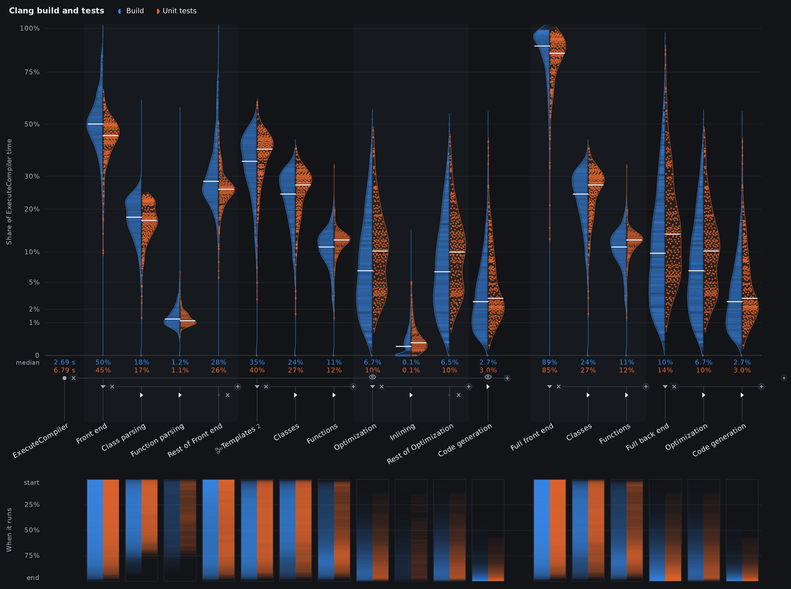

# Violinoscope

Compare where time goes across thousands of requests or compilations. Build a breakdown, compare workloads, and open any dot in a flame chart or waterfall.



[Full Clang build and test example](examples/clang/README.md): 55,989 recorded compilations.

```sh
python3 violinoscope.py before.jsonl after.jsonl --unit "Handle request" -o report.html
```

Open `report.html` in a recent browser. Everything is included; it works offline. Python 3.9+ is the only dependency for generating reports. No server or JavaScript build step.

Accepts **OpenTelemetry** OTLP/Collector JSON, Jaeger JSON, Chrome/Clang time traces, and time-based Linux **perf** exports. Files, directories, quoted globs and gzip work. Dataset names come from `dataset.name`, then `service.name`, then filenames; `baseline=before.jsonl` supplies a name. Omit `--unit` when trace roots share a name.

```sh
# Clang time traces, one compilation per dot
python3 violinoscope.py 'build/*.json' --unit ExecuteCompiler -o clang.html

# Sampled CPU stacks (functions become span names)
perf record -e cpu-clock:u -F 99 --call-graph dwarf -o cpu.data -- ./program
perf script --no-inline -i cpu.data -F comm,pid,tid,time,period,event,ip,sym,dso > cpu.perf.txt
python3 violinoscope.py cpu.perf.txt -o cpu.html
```

Start at the root and use **+** to explore. Drag siblings together to group them; move a span upward to extract its share. Projections give independent views. × deletes; hide keeps a node in the calculation. Ctrl+Z undoes edits; Ctrl+Shift+Z redoes them.

The layout icon manages named layouts and copies/pastes layout JSON. Shift-click its import/export buttons to use files, or supply `--layout overview.layout.json` when generating a report. The picture button copies the phases view; Shift-click downloads a PNG. Downloading the page preserves its current layout.

[Collect local or cluster traces](docs/collecting.md) · [Counting model](docs/model.md) · [Development](docs/development.md) · [MIT license](LICENSE)

Run `python3 violinoscope.py --help` for comparison and labeling options. The default output is `violinoscope.html`; query text is omitted unless `--with-text` is given.
